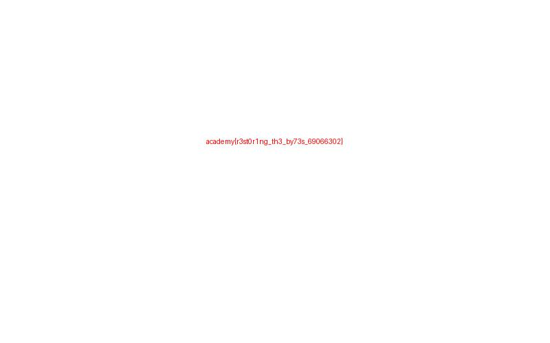

## Descripción

Recuperar un archivo dañado modificando los bytes necesarios.

## Solución

1. Descargar los archivos originales indicados en las referencias y colocarlos juntos en una carpeta de trabajo.

2. La cabecera inicial estaba dañada, pero después aparecía JFIF. Se repararon los primeros tres bytes con la firma JPEG FF D8 FF y se abrió la imagen resultante.

3. Ejecutar el siguiente código con Python 3 desde esa carpeta:

```python
from pathlib import Path
original = Path('file').read_bytes()
print(original[:20].hex())
Path('reparada.jpg').write_bytes(b'\xff\xd8\xff' + original[3:])
# Abrir reparada.jpg: la bandera aparece escrita en rojo.
```

4. El análisis recuperó esta bandera:

```text
academy{r3st0r1ng_th3_by73s_69066302}
```

5. Introducir la bandera en CyLab Security Academy. **Fue aceptada** y se observó `Challenge solved!` el **31 de octubre de 2026**.



## Notas adicionales

Solo se sustituyeron los primeros tres bytes; el resto del contenido se conservó. Se escribió un archivo nuevo para preservar el original.

## Referencias

- [Corrupted file — CyLab Security Academy](https://learn.cylabacademy.org/assignments/13494/519)
- [file](https://challenge-files.cylabacademy.net/library/03e658f970a580c265471fa9e2477a66457bed10e5f89da0fe70c141c3509f3b/file)

