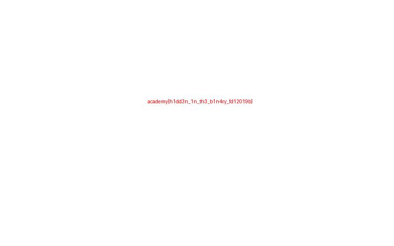

## Descripción

Recuperar información significativa a partir de un archivo de unos y ceros.

## Solución

1. Descargar los archivos originales indicados en las referencias y colocarlos juntos en una carpeta de trabajo.

2. El archivo contiene caracteres 0 y 1. Agrupándolos en octetos se recuperan los bytes de un JPEG; la bandera está escrita en esa imagen.

3. Ejecutar el siguiente código con Python 3 desde esa carpeta:

```python
from pathlib import Path
bits = ''.join(Path('digits.bin').read_text().split())
assert len(bits) % 8 == 0
imagen = bytes(int(bits[i:i+8], 2) for i in range(0, len(bits), 8))
print(imagen[:10].hex())
Path('recuperada.jpg').write_bytes(imagen)
# Abrir recuperada.jpg y transcribir la bandera.
```

4. El análisis recuperó esta bandera:

```text
academy{h1dd3n_1n_th3_b1n4ry_fd12019b}
```

5. Introducir la bandera en CyLab Security Academy. **Fue aceptada** y se observó `Challenge solved!` el **31 de octubre de 2026**.



## Notas adicionales

La salida empieza con FF D8 FF E0 y el identificador JFIF. La extensión .bin no describe necesariamente el formato del contenido.

## Referencias

- [Binary Digits — CyLab Security Academy](https://learn.cylabacademy.org/assignments/13494/698)
- [digits.bin](https://challenge-files.cylabacademy.net/library/86570bf97a45f6374b4d3acb666203f98deb9ad1368d23b1d5ca1e5531391e1b/digits.bin)
