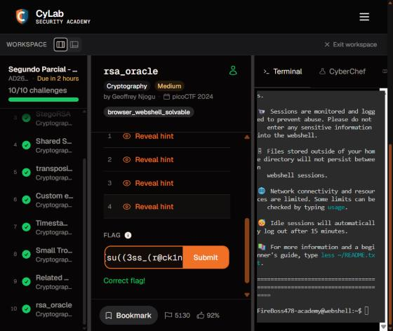

## Descripción

Un atacante interceptó el mensaje cifrado (`secret.enc`) y la contraseña cifrada con RSA (`password.enc`) que se usó para cifrarlo. Hay un oráculo que descifra cualquier cosa **excepto** la contraseña. Hay que recuperar la contraseña abusando del oráculo y usarla para descifrar el mensaje.

## Solución

1. Descargar `secret.enc` y `password.enc` y lanzar una instancia del reto en CyLab para obtener el host y puerto del oráculo (en esta resolución, `chatelaine.cylabacademy.net:15490`).

2. `password.enc` es el entero `c = p^e mod n` (la contraseña `p` cifrada con RSA sin padding). `secret.enc` empieza por `Salted__`, es decir, datos de `openssl enc`. El oráculo expone dos opciones: `E` cifra un texto (lo pasa a bytes → entero `m` → `m^e mod n`) y `D` descifra un entero (`c^d mod n`), pero rechaza el ciphertext exacto de la contraseña.

3. **Ataque por multiplicatividad de RSA (textbook, sin padding).** RSA cumple que `(a·b)^d ≡ a^d · b^d (mod n)`. Se pide al oráculo que cifre el entero `2` (enviando el byte `\x02`), se obtiene `c2 = 2^e mod n`, se multiplica por el ciphertext de la contraseña y se pide descifrar el producto. El oráculo no reconoce `c·c2` como la contraseña y devuelve `2·p mod n`; como `p` es pequeña, `2p < n`, así que basta dividir entre 2 para recuperar `p` y convertirla a texto.

4. Ejecutar el siguiente código con Python 3 (solo biblioteca estándar) ajustando `HOST`, `PORT` y `C` al valor de `password.enc`:

```python
import socket, re

HOST, PORT = "chatelaine.cylabacademy.net", 15490
C = int(open("password.enc").read().strip())   # c = p^e mod n

def recv_until(s, token):
    data = b""
    while token not in data:
        data += s.recv(4096)
    return data

s = socket.create_connection((HOST, PORT))
# --- E: cifrar el entero 2 (byte \x02) ---
recv_until(s, b"decrypt.")
s.sendall(b"E\n")
recv_until(s, b"encrypt")
s.sendall(b"\x02\n")
resp = recv_until(s, b"mod n)").decode()
c2 = int(re.search(r"mod n\)\s*(\d+)", resp).group(1))   # c2 = 2^e mod n

# --- D: descifrar c * c2  ->  2p mod n ---
recv_until(s, b"decrypt.")
s.sendall(b"D\n")
recv_until(s, b"decrypt:")
s.sendall(str(C * c2).encode() + b"\n")
resp = recv_until(s, b"decrypted ciphertext:").decode()
twop = int(re.search(r"as hex \(c \^ d mod n\):\s*([0-9a-fA-F]+)", resp).group(1), 16)
s.close()

p = twop // 2
password = p.to_bytes((p.bit_length() + 7) // 8, "big")
print("password:", password.decode())   # 88a12
```

5. El descifrado devolvió `2p = 0x7070c26264`; dividido entre 2 da `0x3838613132`, es decir la contraseña ASCII **`88a12`**.

6. `secret.enc` se descifra con OpenSSL usando esa contraseña (AES-256-CBC con derivación de clave SHA-256):

```sh
openssl enc -aes-256-cbc -d -md sha256 -in secret.enc -k 88a12
```

7. La bandera obtenida:

```text
academy{su((3ss_(r@ck1ng_r3@_88a127f1}
```

8. Introducir la bandera en CyLab Security Academy. **Fue aceptada** y se observó `Correct flag!` el **31 de octubre de 2026**.



## Notas adicionales

- La vulnerabilidad es el RSA sin relleno (*textbook RSA*), que es homomórfico respecto a la multiplicación. Por eso un oráculo de descifrado es explotable aunque se niegue a descifrar un único ciphertext concreto: basta disfrazarlo multiplicándolo por el cifrado de un factor conocido.
- No hace falta conocer `n` ni `e`: el oráculo cifra `2` por nosotros y, al descifrar, reduce módulo `n` internamente, por lo que se puede enviar `c·c2` sin reducir.
- El factor 2 funciona porque `2p` sigue siendo menor que `n`; si no lo fuera, habría que elegir un factor pequeño o deshacer la reducción módulo `n`.
- La contraseña y la bandera son específicas de cada instancia (la bandera incorpora `88a12…`), por lo que la flag debe enviarse mientras la instancia que la generó siga activa.
- En este equipo no había Python ni Node disponibles, así que la interacción con el oráculo se realizó con un script equivalente en Perl (`IO::Socket::INET` + `Math::BigInt`); el procedimiento y los valores son idénticos a los del código anterior. Los archivos `secret.enc` y `password.enc` se enlazan desde sus orígenes y no se incorporan al repositorio.

## Referencias

- [rsa_oracle — CyLab Security Academy](https://learn.cylabacademy.org/assignments/13495/422)
- [secret.enc](https://challenge-files.cylabacademy.net/library/c160444b2e2c0d9b093294670f0feec4d0e65abfcfc56e9524fb337c65cb9110/secret.enc)
- [password.enc](https://challenge-files.cylabacademy.net/library/c160444b2e2c0d9b093294670f0feec4d0e65abfcfc56e9524fb337c65cb9110/password.enc)
